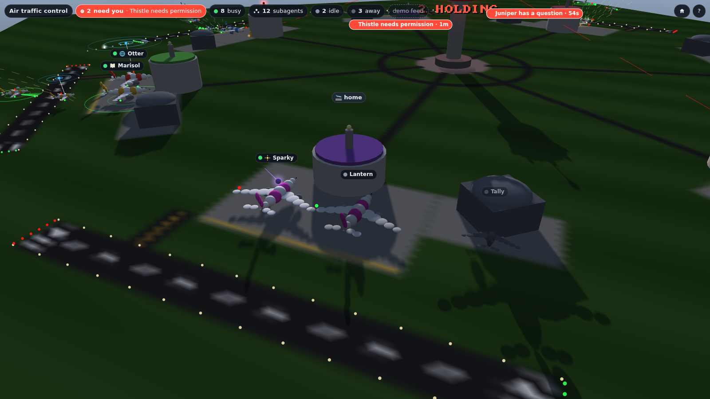
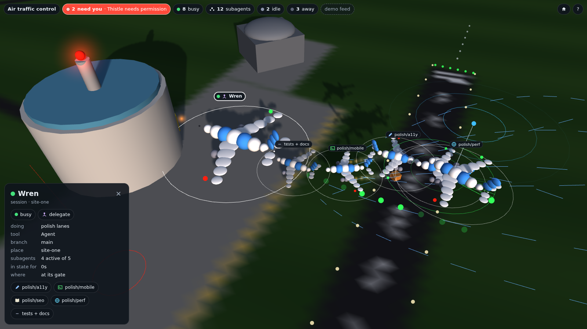
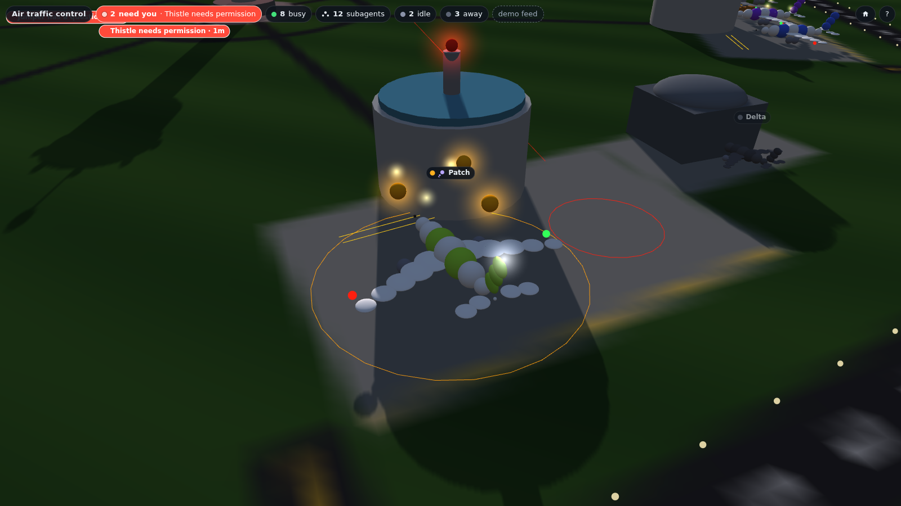
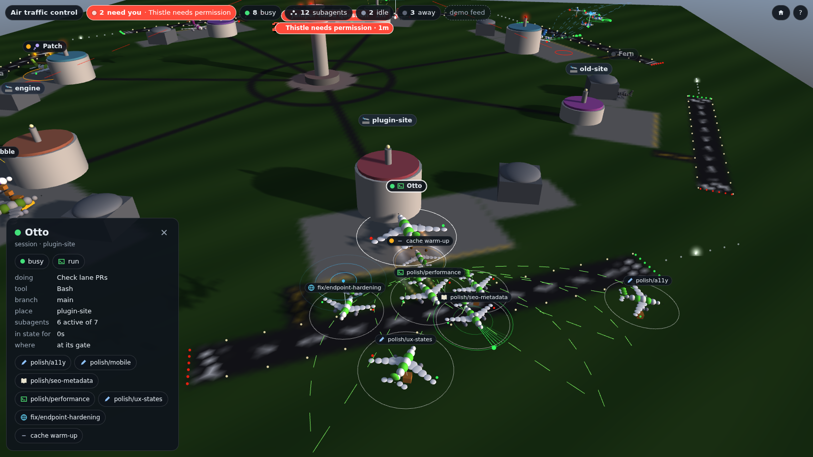
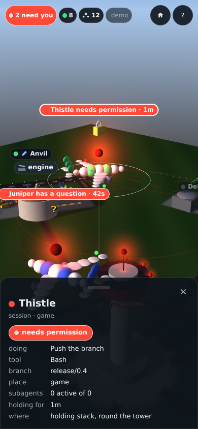
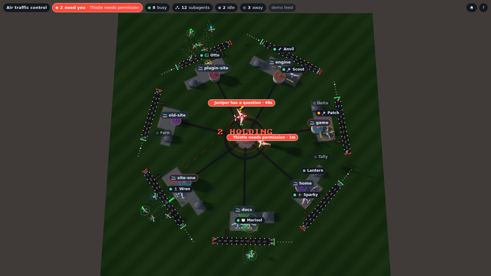
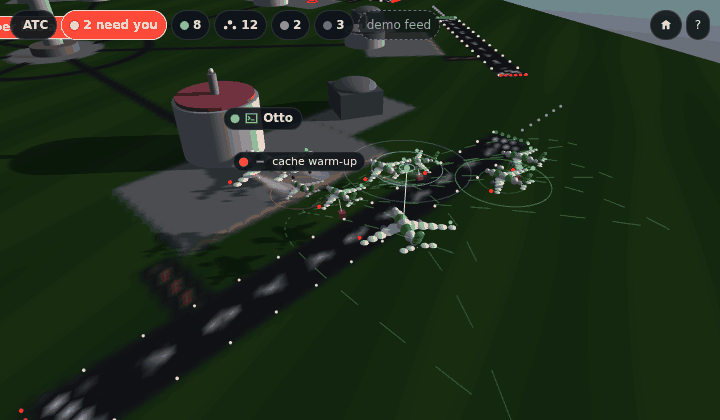

# agentviz-atc

Your Claude Code sessions and their subagents shown as air traffic control,
drawn with [Strata](https://github.com/Preponderous-Software/strata). The
page is built around one question: **what needs me right now?** The control
tower in the middle is you. A session that is waiting on you leaves its gate
and joins the **holding stack** circling the tower, with a pulsing red beacon,
and the tower's lamps count how many aircraft are holding.

One of the visualizations in
[agentviz](https://github.com/dmccoystephenson/agentviz). Every image below
comes from the synthetic demo feed (`--fixture`), never from live sessions.


*The whole field. Each repo is an airport on the ring. Leads with subagents
have flights out (dashed loops past their runways). Thistle and Juniper are
waiting on you, so they circle the tower in red, each with a dashed line back
to its empty gate. The chip at the top names who is next and why.*

## Run

Needs Python 3.8 or newer and nothing else:

```bash
git clone https://github.com/dmccoystephenson/agentviz-atc
cd agentviz-atc
python3 -m vendor.agentfeed serve --web web --port 8844             # your live sessions
python3 -m vendor.agentfeed serve --web web --port 8844 --fixture   # the demo feed
```

Open <http://127.0.0.1:8844/> (the server binds 127.0.0.1 only and refuses
non-local `Host` headers). Live mode reads your Claude Code session files
under `~/.claude` and shows session names, states, git branches, tool names
and short labels (a file's basename, a Bash command's own description, a web
host, a subagent's description), never file contents, commands or prompts;
see the agentviz [SECURITY.md](https://github.com/dmccoystephenson/agentviz/blob/main/SECURITY.md).
`?fixture=1` shows the demo feed with either server, and `?fps=1` shows the
kit's frame stats.

Drag to orbit, scroll or pinch to zoom, right-drag or two-finger drag to pan.
Tap an aircraft to open its panel (a bottom sheet on a phone; swipe it down or
tap the cross to close). The red **need you** chip names who is waiting and
why (a question, or a permission prompt), flies the camera to them and cycles
through them; the house button shows the whole field again; `?` opens the
legend. The top bar stays on one line however narrow the window: the count
words, then the chip's "who" go first, and on a phone the idle and away counts
(the field shows those aircraft). On a phone a tapped aircraft glides into the
clear band above the sheet, and world labels never sit under the bar or the
sheet. If the feed stops answering, a banner says so and the last snapshot
stays; with no sessions at all, a hint says how to start.

## What you're seeing

| Visual | Meaning | Feed |
|---|---|---|
| 🗼 Control tower in the centre | you (the owner) | |
| Red lamps round the tower cab, flashing red mast beacon, `N HOLDING` | how many sessions are waiting on you; a green beacon means `ALL CLEAR` | sessions with `state: waiting` |
| 🛬 Aircraft circling the tower with a pulsing red beacon | **waiting**: blocked on you. The longer it has waited, the higher it sits in the stack and the faster it pulses. A dashed red line runs back to its gate, where a red ring pulses | `state: waiting`, `statusAgeSec` |
| A yellow "?" over the beacon / a padlock over it | waiting on a question / on a permission prompt; its label says which | `waitingReason` |
| Airport (round terminal, apron, runway with approach lights and their running flash, hangar) | a place (a repo, by directory name); its beacon flashes red while one of its aircraft is holding | `places[]` |
| A taller terminal | more tool calls seen at that repo | `places[].toolCount` |
| ✈️ Large aircraft at a gate, nav lights and strobe on | a session that is working | `state: busy` |
| Fin and livery colour | the session's family: its subagents carry the same colour | `seed` |
| 🛩️ Small aircraft flying a dashed loop out from behind a gate | an active subagent of that gate's session | `followers[].state: active` |
| 🅿️ Small aircraft parked in a row behind its lead | a resting subagent (landed) | `followers[].state: resting` |
| Darker aircraft at a gate, lights off | idle | `state: idle` |
| Small grey aircraft by the hangar | offline | `state: offline` |
| Three flashing amber lights and an amber ring | stalled: a session busy with nothing written for 5 minutes, or a subagent quiet that long without finishing (a stalled subagent is always labelled) | `stalled`, `followers[].stalled` |
| A cyan ring going out and the landing light flashing | a new tool call, just now | `lastToolAt`, `followers[].toolCount` |
| 📦 Belt loader carrying crates into the hold (a slung crate in flight) | **edit** | `action: edit` |
| 🔥 Exhaust streaming from both engines | **run** | `action: run` |
| 📡 Green radar scope with a turning beam | **read** | `action: read` |
| 📻 Mast with cyan rings going out | **web** | `action: web` |
| 🛫 Green chase lights running out from the gate, marshaller's wands | **delegate** | `action: delegate` |
| ⏸️ Yellow hold-short bar and lights circling the cockpit | **think** | `action: think` |
| ✳️ Violet rotating roof beacon | **other** | `action: other` |

## Close-ups

| | |
|---|---|
|  |  |
| *A lead and its subagents. Otto (plugin-site) is running a command (exhaust). Its active subagents fly loops out from behind its gate, each showing its own action: cargo, radar, exhaust, radio rings. Its stalled, resting subagent is parked behind it in an amber ring.* | *The holding stack. Juniper has a question (the "?"), Thistle needs permission (the padlock). Both circle the tower with pulsing beacons; the cab glass turns red and one lamp is lit for each aircraft holding.* |
|  |  |
| *Idle and offline at `home`. Lantern is parked at its gate with its lights off. Tally is offline: small and grey on the hangar pad. Sparky is busy with something else (the violet beacon).* | *Delegating and resting. Wren's gate is launching flights (green chase lights out to the field). Selected, its subagents are labelled; the resting one, "tests + docs", is parked behind it.* |
|  |  |
| *Stalled. Patch has been busy with nothing written for over 5 minutes: three amber lights turn over it and an amber ring circles it. Thistle's empty gate beside it pulses red.* | *Edit and think at `engine`. Anvil is editing: crates ride the belt loader up into its hold. Scout is thinking behind a yellow hold-short bar. Pebble, a shell, sits dimmed.* |

### The panel, two more angles, a phone and motion

| | |
|---|---|
|  |  |
| *The panel for a selected aircraft: state, what it is doing now, tool, branch, airport, how long in this state, and each subagent as a chip you can tap to fly the camera to it. A subagent's own panel shows its own branch.* | *Phone (390x844, DPR 3): the bottom sheet open on Thistle, which needs permission. The top bar keeps to one line.* |
|  |  |
| *From a low angle: the tower and its holding stack against the sky.* | *From straight above: the ring of airports, the service roads and the flight loops.* |


*Five seconds of motion at plugin-site: subagents fly their loops, exhaust streams, the radar turns.*

## Build and test

```bash
python3 -m unittest discover -s tests       # serves the fixture; page, assets, feed, vendored PINs
npm ci && npx playwright install chromium   # Playwright 1.61.1, for the browser tests
pip install -r requirements-dev.txt         # Pillow, for the GIF
npm run smoke                               # headless Chromium on the demo feed; saves docs/media/screenshot.png
npm run screenshots                         # every image above (or some: npm run screenshots -- hero phone motion)
EMSDK=/path/to/emsdk vendor/agentviz-kit/scene/build-scene.sh scene/kit.conf   # rebuild web/atc-engine.*
```

The built engine files are committed, so serving needs only Python. The unit
tests use port 9108 (`ATC_UNIT_PORT` overrides), the browser tests 9109
(`ATC_TEST_PORT`). `vendor/agentfeed/`, `vendor/agentviz-kit/` and
`web/agentviz-*` come from [agentviz](https://github.com/dmccoystephenson/agentviz)
(`tools/vendor-kit.sh`); do not edit them here.

## How it works

The feed client, the HUD (chips, the selected-agent panel and bottom sheet,
the banner), world labels, tap picking and the page-to-engine data format are
the shared agentviz kit (docs/KIT.md in agentviz). On top of it,
`web/atc-field.js` keys every aircraft by id, puts one airport per place on a
ring round the tower, gives each session a gate, each resting subagent a stand
behind it and each active subagent a loop past the runway, sends waiting
sessions to the holding stack, and eases every aircraft toward where its state
puts it. Each frame `web/atc-frame.js` packs the field in the agentviz wire
format; `scene/main.cpp` decodes it with `agentviz.h` and draws it with
Strata's primitives, lines, points and point lights (`terrain.h`, `tower.h`,
`airport.h`, `aircraft.h`, `actions.h`, `holding.h`).

## Licence

Code: [MIT](LICENSE). Screenshots and GIFs in `docs/media/`:
[CC0 1.0](LICENSE-media). The committed engine bundles Strata (MIT) and its
libraries, and the Emscripten runtime: see
[THIRD_PARTY_NOTICES.md](THIRD_PARTY_NOTICES.md).
