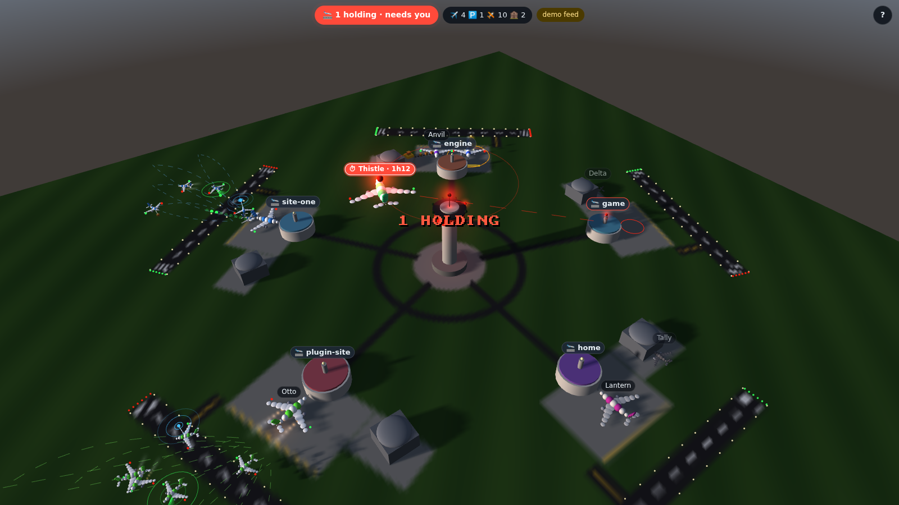
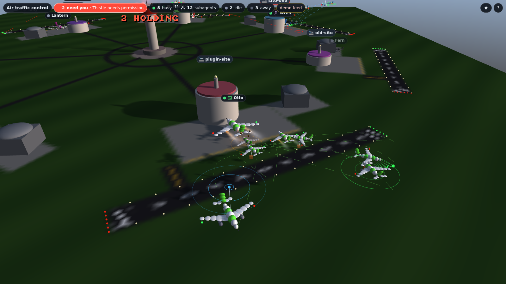
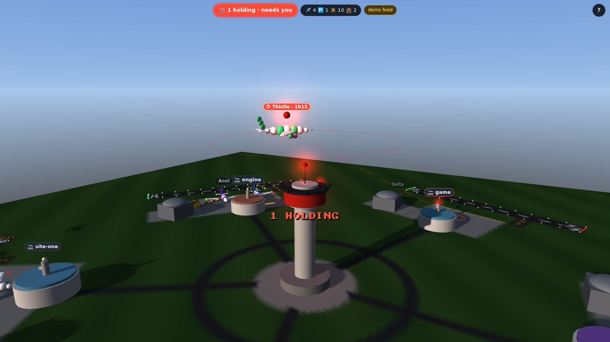
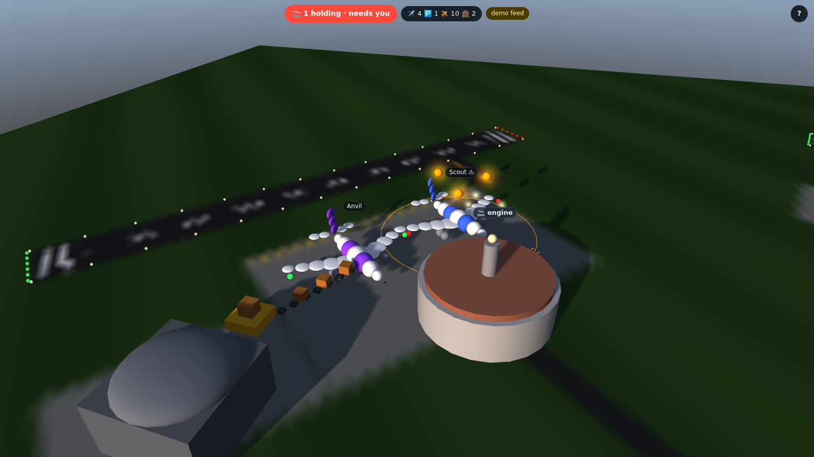
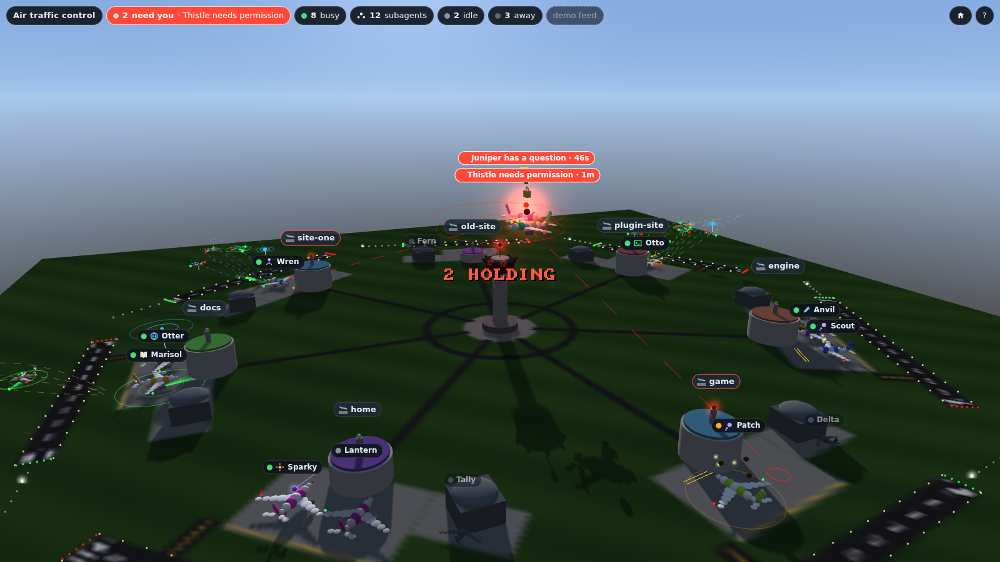

# agentviz-atc

Your Claude Code sessions and their subagents shown as air traffic control,
drawn with [Strata](https://github.com/Preponderous-Software/strata). The
page is built around one question: **what needs me right now?** The control
tower in the middle is you. A session that is waiting on you leaves its gate
and joins the **holding stack** circling the tower, with a pulsing red beacon,
and the tower's lamps count how many aircraft are holding.

One of the ten visualizations in
[agentviz](https://github.com/dmccoystephenson/agentviz). Every image below
comes from the synthetic demo feed (`--fixture`), never from live sessions.


*The whole field. Each repo is an airport on the ring. Two leads have
flights out (dashed routes). Thistle is waiting on you, so it circles the tower
in red, with a dashed line back to its empty gate at `game`.*

## Run

```bash
python3 -m vendor.agentfeed serve --web web --port 8844             # live sessions on this machine
python3 -m vendor.agentfeed serve --web web --port 8844 --fixture   # the demo feed
```

Open <http://127.0.0.1:8844/>. `?fixture=1` shows the demo feed with either
server, and `?fps=1` shows the kit's frame stats. The server binds to
127.0.0.1 only.

Drag to orbit, scroll or pinch to zoom, right-drag or two-finger drag to pan.
Tap an aircraft to open its panel (a bottom sheet on a phone). The red
**holding** chip at the top jumps to whoever is waiting on you, and `?` opens
the legend.

## What you're seeing

| Visual | Meaning | Feed |
|---|---|---|
| 🗼 Control tower in the centre | you (the owner) | |
| Red lamps round the tower cab, flashing red mast beacon, `N HOLDING` | how many sessions are waiting on you; a green beacon means `ALL CLEAR` | `counts.waiting` |
| 🛬 Aircraft circling the tower with a pulsing red beacon | **waiting**: blocked on you (a permission prompt or a question). The longer it has waited, the higher it sits in the stack and the faster it pulses. A dashed red line runs back to its gate, where a red ring pulses | `state: waiting`, `statusAgeSec` |
| Airport (round terminal, apron, runway, hangar) | a place (a repo, by directory name); its beacon flashes red while one of its aircraft is holding | `places[]` |
| ✈️ Large aircraft at a gate, nav lights and strobe on | a session that is working | `state: busy` |
| Fin and livery colour | the session's family: its subagents carry the same colour | `seed` |
| 🛩️ Small aircraft flying a dashed loop out from behind a gate | an active subagent of that gate's session | `followers[].state: active` |
| 🅿️ Small aircraft parked in a row behind its lead | a resting subagent (landed) | `followers[].state: resting` |
| Darker aircraft at a gate, lights off | idle | `state: idle` |
| Small grey aircraft by the hangar | offline | `state: offline` |
| Three flashing amber lights and an amber ring | stalled: busy, but nothing written for 5 minutes | `stalled` |
| 📦 Belt loader carrying crates into the hold (a slung crate in flight) | **edit** | `action: edit` |
| 🔥 Exhaust streaming from both engines | **run** | `action: run` |
| 📡 Green radar scope with a turning beam | **read** | `action: read` |
| 📻 Mast with cyan rings going out | **web** | `action: web` |
| 🛫 Green chase lights running out from the gate, marshaller's wands | **delegate** | `action: delegate` |
| ⏸️ Yellow hold-short bar and lights circling the cockpit | **think** | `action: think` |
| ✳️ Violet rotating roof beacon | **other** | `action: other` |

## Close-ups

| | |
|---|---|
|  |  |
| *A lead and its subagents. Otto (plugin-site) is running a command (exhaust). Its six subagents fly loops out from behind its gate, each showing its own action: cargo, radar, exhaust, radio rings.* | *The holding stack. Thistle is waiting on you. It circles the tower with a pulsing beacon, the cab glass turns red and one lamp is lit for each aircraft holding.* |
|  |  |
| *Idle and offline. Lantern is parked at its gate with its lights off. Tally is offline: small and grey on the hangar pad.* | *Delegating and resting. Wren's gate is launching flights (green chase lights out to the field). Its resting subagent, "tests + docs", is parked behind it.* |
|  |  |
| *Two sessions at one airport: Anvil is editing (crates going up the belt loader) and Scout is thinking (hold-short bar, lights circling the cockpit).* | *The panel for a selected aircraft: state, what it is doing now, label, branch, airport, and its subagents. Tap one to fly the camera to it.* |

### Two more angles, a phone and motion

| | |
|---|---|
|  |  |
| *From a low angle: the tower and its holding stack against the sky.* | *From straight above: the ring of airports, the service roads and the flight loops.* |
|  |  |
| *Phone (390x844, DPR 3): the bottom sheet open on the waiting session.* | *Five seconds of motion: subagents fly their loops, exhaust streams, the radar turns.* |

## Build, test, capture

The built engine (`web/atc-engine.{js,wasm}`) and the kit's page scripts are
committed, so serving needs only Python 3.8+.

```bash
scene/build.sh                                    # rebuild the scene (emsdk 6.0.11; fetches Strata 0.10.0 into .strata/)
python3 -m unittest discover -s tests             # serves the fixture; page, assets and feed return 200 and parse
NODE_PATH=<node_modules with playwright> node tests/smoke.cjs        # headless Chromium: draws, no console errors, a tap opens the panel
NODE_PATH=<node_modules with playwright> node tests/screenshots.cjs  # regenerates every image in docs/media/
```

The browser tests start their own fixture server on port 8944.

- `scene/main.cpp`: the Strata web-kit scene. It only draws what it is given
  each frame: airports, aircraft and lines.
- `web/atc.js`: polls `/api/agents` every 2 s, lays out the field, keys
  aircraft by id and eases them between snapshots. It also handles picking,
  labels and the panel.
- `vendor/agentfeed/`: the shared feed, vendored from agentviz (see `PIN`).
  Don't edit it here.
